# FDE Lifecycle Lab

**Can an AI agent do the job — and prove it?**

A research-grade measurement harness for **forward-deployed engineering (FDE)**: the work of turning a promising AI demo into a system a customer can actually operate, govern, and hand over.

[](preview.html)
[](assets/demo.mp4)

> **Viewing the preview:** GitHub shows `.html` files as source. After the owner enables GitHub Pages (Settings → Pages → GitHub Actions), the published site opens the live lab. Until then, download the repository and open `preview.html` in a browser. Deployment steps: [docs/PUBLISHING.md](docs/PUBLISHING.md).

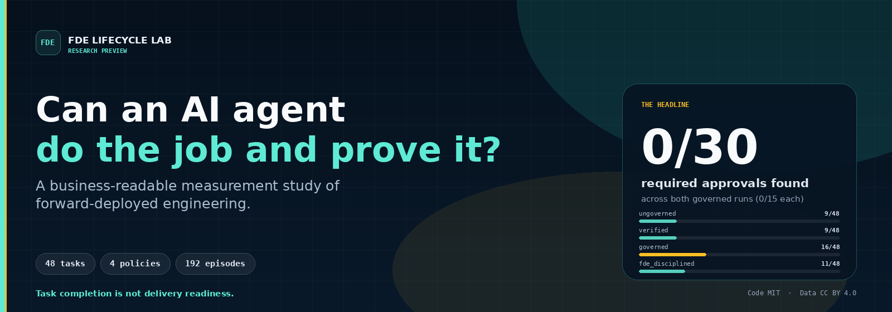

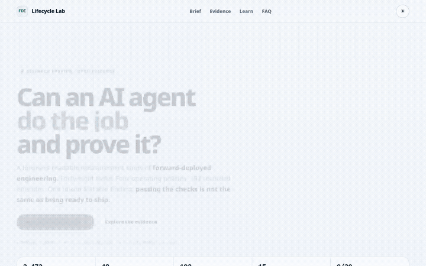

**Research preview.** 48 benchmark tasks · 4 operating policies · 192 recorded episodes · 1 small local model · 15 recorded errors. The headline is not “AI wins.” It is a boundary: **passing the checks is not the same as being ready to ship.**

> **Read this first:** this is an early-stage research asset, not a production certification, vendor ranking, or guarantee of savings. The useful question is not “how high is the score?” It is “what does the score leave out?”

---

## Abstract

Enterprise AI agents are easy to demonstrate and hard to deliver. Forward-deployed engineering is the human layer that closes that gap: embed with the customer, discover the workflow, build against real constraints, deploy into a governed environment, and hand the system to an owning team. This repository turns that delivery problem into a measurable, reproducible study. It combines a point-in-time snapshot of 3,473 public job postings, a 48-task six-phase benchmark, four operating policies, 192 recorded episodes on a small local model, a prompt-injection guardrail evaluation, a deployment smoke test, and a shadow-price cost model. The central result is a boundary, not a leaderboard: task completion was modest, one check-driven repair attempt changed 0 of 48 scores, and 0 of 15 high-risk outputs in each of the governed and disciplined runs contained the required human approval (0 of 30 combined), even though 11 passed every task check. The practical implication is simple: evaluate task quality, governance, review cost, and deployment evidence separately before committing to an AI delivery pilot. This is a research probe, not a production certification or vendor ranking.

**Understand:** [60-second brief](#-the-60-second-brief) · [Who this is for](#-who-this-is-for) · [Features](#-features) · [Use cases](#-what-you-can-do-with-it) · [Beginner guide](#-beginner-guide--read-this-and-you-are-a-professional) · [FAQ](#-faq) · [Glossary](#-glossary)

**Verify:** [Evidence lab](#-evidence-lab) · [Data integrity](#-data-integrity-and-reproducibility) · [Limitations](#-limitations--what-this-does-not-prove) · [Quick start](#-quick-start) · [License](#-license-and-citation)

---

## 📌 The 60-second brief

Most agent evaluations stop at task success. This project separates four things a buyer actually has to decide:

| Question | What this repository measures | Why it matters |
|---|---|---|
| **Can it do the work?** | Task resolution across six FDE phases | A demo can pass a happy path; delivery needs repeatable artifacts |
| **Is it approved?** | Human-approval coverage on high-risk work | A perfect artifact can still be unapproved |
| **What does it cost?** | Model cost plus human review time | Review, not tokens, dominates at low resolution rates |
| **Can it ship?** | Canonical smoke tests and generated-artifact parsing | “It starts” is not “it works” |

**The one-sentence business case:** this repository gives a team a shared language for separating *task quality*, *governance quality*, and *deployment evidence* before it commits to an AI delivery pilot.

**The sentence to remember:** *An agent can look finished and still be unapproved.*

### What the evidence says

- **Task resolution is modest.** Ungoverned and verified each resolved **9/48** tasks. Governed resolved **16/48**; the disciplined loop resolved **11/48**.
- **Check-driven repair did not move the score.** Verified changed **0 of 48** paired scores; **40 of 46** non-error artifacts were byte-identical to the ungoverned baseline, and 2 more pairs were both errors.
- **Governance is a separate outcome.** Both governed and disciplined policies had **0/15** required high-risk approvals (15 each; **0/30** combined). **11** high-risk episodes passed every task check while omitting approval.
- **More process was not automatically better.** The disciplined loop changed 23 scores: **8 improved, 15 worsened**, and recorded **10 errors**.
- **Deployment claims are narrow.** Canonical smoke tests were healthy **3/3**, but only **1 of 32** generated deployment artifacts parsed to a Compose services map; none were executed.

[Read the full evidence](#-evidence-lab) · [Take the beginner path](#-beginner-guide--read-this-and-you-are-a-professional) · [See what this does not prove](#-limitations--what-this-does-not-prove)

---

## 🎯 Who this is for

| Reader | What you can take from it |
|---|---|
| **Founder / executive** | A buyer-side framework for evaluating an AI delivery pilot without confusing a demo with readiness |
| **FDE or solutions lead** | A phase-by-phase view of where delivery breaks, plus a reusable task bank |
| **AI platform / governance lead** | A concrete example of approval coverage being measured separately from task quality |
| **Enterprise architect** | Evidence for why review time and deployment scope belong in the operating model |
| **Hiring manager / candidate** | A practical vocabulary for FDE interviews, portfolio reviews, and take-home exercises |
| **Researcher** | A reproducible null result, a small task bank, and an explicit list of threats to validity |

**Not for:** claiming production safety, ranking model vendors, or replacing legal, security, and domain review.

---

## ✨ Features

- **A frozen, auditable benchmark.** 192 episodes across four policies, pinned by SHA-256, with errors preserved rather than dropped.
- **Task quality separated from governance.** Task checks and human-approval coverage are reported as different outcomes.
- **A reusable six-phase task bank.** Discovery, architecture, security, context, deployment, and handover, with reference artifacts that pass their own checks.
- **Four operating policies.** Single-call, check-driven repair, governed, and a plan → artifact → critique → repair loop.
- **A guardrail tradeoff study.** Rule and classifier baselines with precision, recall, F1, and false-positive rate at multiple thresholds.
- **Deployment evidence with a narrow claim.** Canonical Compose smoke tests plus generated-artifact parsing, clearly separated from execution.
- **A point-in-time labor-market snapshot.** 3,473 public postings, title classes, skills, remote share, and salary-mention heuristics.
- **A shadow-price cost model.** Token cost plus loaded human-review time, so the operating model is visible.
- **A reproducible pipeline.** Task generation, freeze, statistics, figures, LaTeX, and verification.
- **A beginner-to-pro learning lab.** Seven short lessons, a six-question quiz, a glossary, and an interview-ready summary.

---

## 💼 What you can do with it

| Use case | A useful output | Guardrail |
|---|---|---|
| **Evaluate a vendor or internal agent** | A scorecard with task resolution, approval coverage, review hours, and deployment evidence | Do not compare numbers produced under different prompts, models, or error policies |
| **Design an approval gate** | A list of high-risk actions and the evidence required before approval | Approval must be a check, not a polite request in a prompt |
| **Triage a delivery pilot** | The phase where failures cluster and the review cost per resolved task | A 48-row task bank is a probe, not a population estimate |
| **Plan an operating model** | Human review minutes, queue volume, and shadow cost per resolved task | Human review is an assumption until you measure it in your own workflow |
| **Onboard a team** | Seven short lessons, a glossary, and a six-question quiz | The quiz tests concepts, not production competence |
| **Reproduce or extend the study** | A frozen 192-row dataset, explicit seeds, and a task bank | Report nulls and errors, not only wins |

### Commercial conversations

Use this repository as a **discovery and pilot-design asset**, not a proof of ROI:

1. **Discovery:** map one customer workflow to the six phases and identify the approval points.
2. **Baseline:** run a small, pre-registered evaluation on the customer’s own tasks and model.
3. **Pilot:** measure resolution, approval coverage, review time, error rate, and deployment evidence.
4. **Decision:** scale only if the customer’s own data clears the pre-agreed threshold.

**Do not promise** production safety, guaranteed savings, model superiority, or regulatory compliance from this repository alone. A serious buyer will ask for the boundary conditions; this README gives them to you.

---

## 🖼️ See it

| Asset | What it shows |
|---|---|
| **[Interactive preview](preview.html)** | A responsive, self-contained tour with evidence tabs, a beginner path, and a quiz |
| **`assets/demo.gif`** | A short loop of the preview in action |
| **`assets/demo.mp4`** | A longer walkthrough with controls |
| **`figures/`** | Publication-style benchmark, market, cost, guardrail, and deployment figures |
| **`docs/RESEARCH.md`** | The detailed research report: methods, tables, and threats to validity |
| **[Publishing checklist](docs/PUBLISHING.md)** | GitHub Pages setup, asset checks, and the release sequence |

> The preview is a static page. It works from the repository root or a static host. If the GitHub Pages site is enabled, the root URL opens the same page.

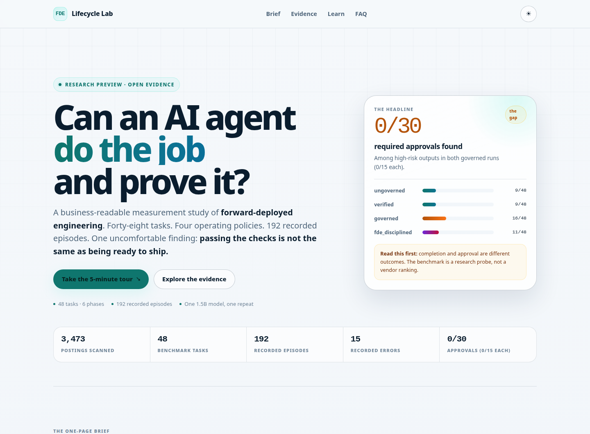

<p align="center">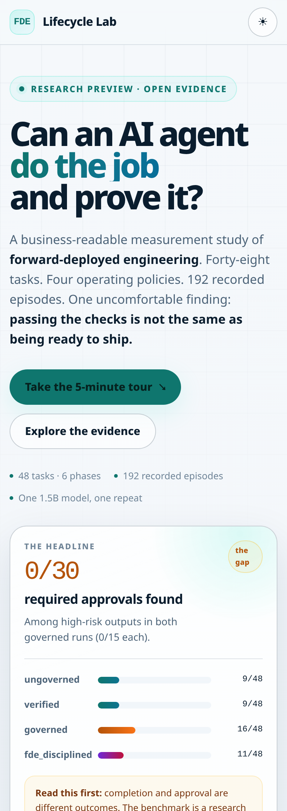</p>

<p align="center"><em>The same evidence, readable on a phone.</em></p>

<p align="center">
  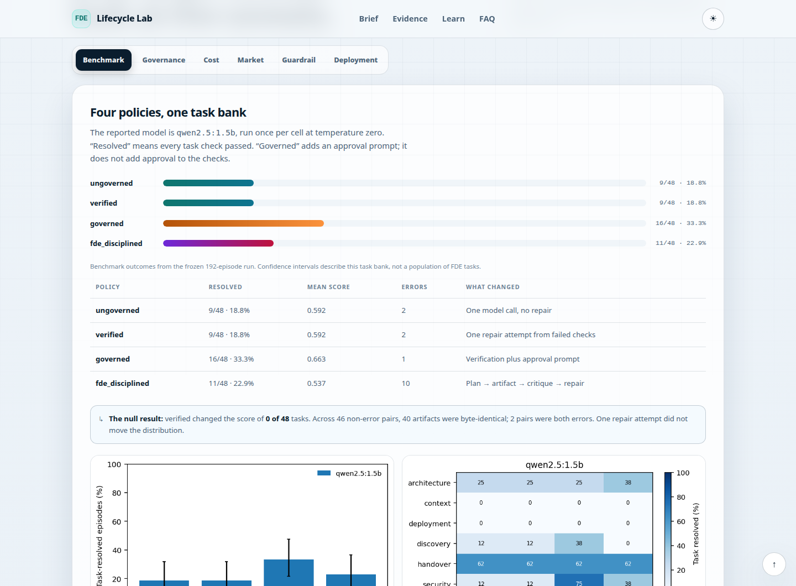
  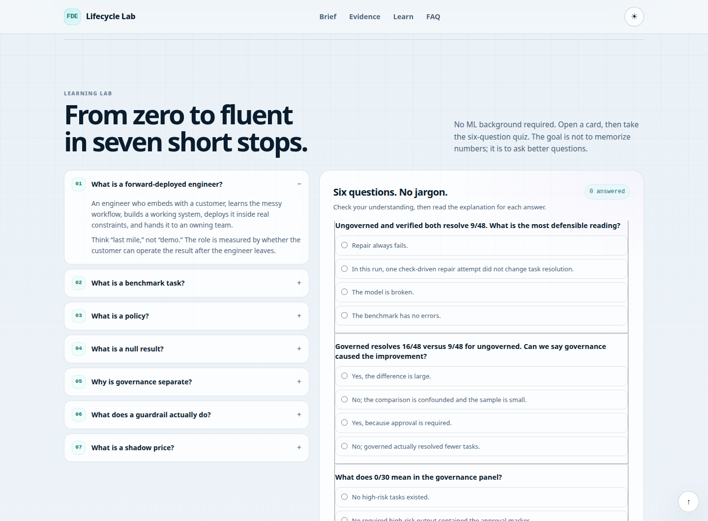
</p>

---

## 🌱 Beginner guide — read this and you are a professional

[Back to top](#fde-lifecycle-lab)

You do not need an ML background to read this repository. You need seven ideas.

You will know more than most interview candidates.

If you can explain these seven ideas without hiding behind jargon, you are ready for the conversations this work is meant to support.

### 1. What is forward-deployed engineering?

An FDE embeds with a customer, learns the real workflow, builds against messy constraints, deploys the result, and hands it to an owning team.

A useful analogy is the **last mile** of a delivery: the model or demo is the package; the FDE builds the route, the loading dock, the paperwork, and the return process. The job is not finished when the package looks good in the warehouse.

### 2. What is a benchmark task?

A task is a small piece of work with four parts:

- a **brief** (what the customer wants),
- **evidence** (what the engineer is given),
- an **instruction** (the constraints and acceptance criteria), and
- **checks** (the machine-verifiable conditions).

A task is **resolved** only when every check passes. A high mean score with a failed check is still not a resolved task.

### 3. What is a policy?

A policy is the process wrapped around the model:

| Policy | Process |
|---|---|
| `ungoverned` | One call, no repair, no approval gate |
| `verified` | One call plus one repair attempt driven by failed checks |
| `governed` | Verification plus an approval prompt for high-risk tasks |
| `fde_disciplined` | Plan → artifact → critique → repair, with approval prompts |

The model can be identical while the policy changes. Always ask which policy produced a number.

### 4. What is a null result?

A null result means the intervention did not change the outcome in this run. Here, one check-driven repair attempt changed **0 of 48** scores.

That is not a claim that repair can never work. It is a claim that **this repair loop, on this task bank, with this small model, did not move the result**. Null results are useful because they stop a team from buying a process that has not been shown to help.

### 5. Why is governance separate from task quality?

A task check can ask, “Does the artifact contain the right fields?” A governance check asks, “Did a human approve the high-risk action?”

They are different:

- **11** episodes passed every task check while omitting the required approval.
- **0/15** required high-risk outputs in each governed run contained the approval marker (**0/30** combined).
- The normalized forbidden-claim safety counter is **0**, but that is not a certification of safety.

The lesson: **put approval in the rubric**. If it lives only in a prompt, the measurement can look better than the delivery process.

### 6. What does a guardrail actually trade off?

A guardrail is not a badge. It is a decision about which errors you prefer.

| Detector | Recall | False-positive rate | Sensible use |
|---|---:|---:|---|
| Regex rules | 3.3% | 0.0% | A tiny, high-precision blocklist |
| Classifier @0.5 | 77.0% | 6.8% | A balanced default |
| Classifier @0.417 | 95.1% | 30.1% | A review queue, not a silent block |

At the high-recall operating point, almost one in three benign examples is flagged. That may be acceptable when a human reviews the queue; it is a poor silent gate.

### 7. How do you read the evidence without overclaiming?

Use this sequence:

1. **Identify the policy** — was the number produced by one call, a repair loop, or a governed loop?
2. **Check the denominator** — 9/48 is not 9/15; 0/15 is not 0/48.
3. **Check the unit** — is the claim about a task, an episode, a phase, or a market posting?
4. **Check the sample** — 48 rows from 6 templates are not 48 independent customer scenarios.
5. **Check the date** — the market snapshot is point-in-time; the model is local and small.
6. **Check the missing evidence** — an approval gap, a parse-only deployment test, or a shadow price is a limitation, not a footnote.

**Interview-ready summary:** “The study separates task resolution from approval coverage and deployment evidence. The verified repair loop was a null result — 0 of 48 scores changed — and the governed run resolved 16 of 48 tasks but had 0 of 15 required approvals. That is why I would measure the operating model, not just the model.”

---

## 🔬 How it works

```text
Public job boards ──► market snapshot ──► role / skill / lifecycle analysis
                                                    │
Task bank (48 rows, 6 phases, 13 instructions) ─────┼──► 4 policies × 48 tasks
                                                    │
                    ┌───────────────────────────────┴───────────────────────┐
                    │                                                       │
              Benchmark run                                        Guardrail test
          (192 episodes, frozen)                             (public injection corpus)
                    │                                                       │
                    ├──► statistics / cost / figures ◄─────────────────────┘
                    │
                    ├──► canonical Compose smoke tests
                    │
                    └──► human-readable report + interactive preview
```

### Architecture in plain English

The system has four layers. **Inputs** are the public job-board snapshot and a synthetic 48-task bank. **Execution** runs four operating policies against the same tasks and records every episode. **Analysis** turns the frozen 192-row run into statistics, cost, guardrail, and deployment evidence. **Presentation** renders those same numbers into this README, the research report, figures, and the static lab.

The layers are deliberately separate: a reader can inspect the raw episodes, regenerate a table, and compare it with the page without trusting a dashboard. The model is one small local model, so this is a measurement harness, not a production serving stack.

The point of the pipeline is not to produce a single leaderboard. It is to keep **four claims** separate:

1. Did the artifact pass the task checks?
2. Did a high-risk action receive approval?
3. What did the run cost, including review?
4. Is there deployment evidence beyond a healthy container?

---

## 🗃️ Where the data comes from

| Data | Source | Size | Used for |
|---|---|---|---|
| Labor-market snapshot | Public applicant-tracking-system job boards | 3,473 postings | Role, skill, remote, and salary-mention analysis |
| Task bank | Synthetic FDE tasks authored for this study | 48 tasks / 283 checks | Benchmark inputs and reference artifacts |
| Benchmark episodes | Local `qwen2.5:1.5b` run at temperature 0 | 192 episodes | Task resolution, governance, errors, cost |
| Guardrail evaluation | Public prompt-injection corpus | Held-out test split | Precision, recall, false-positive tradeoff |
| Deployment evidence | Canonical Compose patterns and generated artifacts | 3 canonical + 32 generated | Smoke tests and parse checks |
| Cost assumptions | Hosted-equivalent token prices and a loaded review rate | Documented in `config/study.yaml` | Shadow cost per episode and per resolved task |

No customer data, private credentials, or proprietary task content is included. Market figures are a point-in-time census of public boards, not a representative sample of the economy.

---

## 📦 What is in the box

| Component | Path | What it does |
|---|---|---|
| Study configuration | `config/study.yaml` | Seeds, models, policies, sources, price assumptions |
| Role and skill taxonomy | `config/taxonomy.yaml` | Regexes for roles, skills, lifecycle phases, forbidden claims |
| Task bank | `data/benchmark/tasks.json` | 48 materialized tasks with checks and reference artifacts |
| Benchmark harness | `src/fde_research/benchmark.py` | Runs models × policies, resumes, writes JSONL |
| Freeze tool | `src/fde_research/freeze_run.py` | Normalizes and hashes a run before analysis |
| Statistics | `src/fde_research/stats.py` | Wilson intervals, paired tests, Friedman test |
| Cost model | `src/fde_research/cost_model.py` | Shadow token prices plus loaded human-review cost |
| Guardrail evaluation | `src/fde_research/guardrail_eval.py` | Rule baseline and TF-IDF + logistic regression |
| Deployment evaluation | `src/fde_research/deployment_eval.py` | Canonical Compose smoke tests |
| Report generator | `src/fde_research/report.py` | Regenerates `docs/RESEARCH.md`, LaTeX numbers, and tables |
| Frozen run | `results/frozen/benchmark_episodes_final.jsonl` | 192 normalized episodes, SHA-256 pinned |
| Interactive page | `preview.html` | Static, responsive, no backend, no external JavaScript |

### Repository map

```text
.
├── README.md                  ← you are here
├── preview.html               ← interactive evidence + learning lab
├── index.html                 ← GitHub Pages entry point
├── 404.html                   ← custom missing-page page
├── assets/                    ← GIF, video, screenshots, social preview
├── docs/
│   ├── RESEARCH.md            ← full research report
│   └── PUBLISHING.md          ← GitHub Pages and release checklist
├── config/                    ← study configuration and taxonomy
├── data/benchmark/tasks.json  ← 48-task bank
├── figures/                   ← publication figures
├── paper/                     ← LaTeX paper sources
├── results/
│   ├── benchmark_episodes.jsonl
│   ├── benchmark_summary.json
│   ├── cost_model.json
│   ├── statistics.json
│   └── frozen/
│       ├── benchmark_episodes_final.jsonl
│       ├── benchmark_summary_final.json
│       └── manifest_final.json
├── src/fde_research/          ← pipeline code
├── tests/                     ← unit tests
└── Makefile                   ← reproducible commands
```

---

## 📊 Evidence lab

The numbers below come from the **frozen 192-episode run**. The local file is pinned by SHA-256, so the analysis can be checked rather than trusted.

### Benchmark: four policies, one task bank

| Policy | Task resolved | 95% CI | Mean score | Required approvals | Errors |
|---|---:|---:|---:|---:|---:|
| `ungoverned` | 9/48 (18.8%) | 10.2%–31.9% | 0.592 | n/a | 2 |
| `verified` | 9/48 (18.8%) | 10.2%–31.9% | 0.592 | n/a | 2 |
| `governed` | 16/48 (33.3%) | 21.7%–47.5% | 0.663 | 0/15 | 1 |
| `fde_disciplined` | 11/48 (22.9%) | 13.3%–36.5% | 0.537 | 0/15 | 10 |

**The verification null.** The ungoverned and verified policies both resolved 9/48 tasks. Verified changed **0** paired scores; **40** non-error artifacts were byte-identical, **2** additional pairs were both errors, and **37** verified episodes made a second call. The repair loop consumed calls without moving the outcome distribution.

**The disciplined loop.** It changed **23** paired scores: **8 improved** and **15 worsened**. More process produced more variation and more errors in this run.

**The phase view.** Resolution was not uniform: handover was the easiest phase (62.5% across policies), while context and deployment resolved **0/32** across all four policies (0/8 within every policy). These are descriptive slices of 32 episodes per phase; do not treat them as stable difficulty estimates.

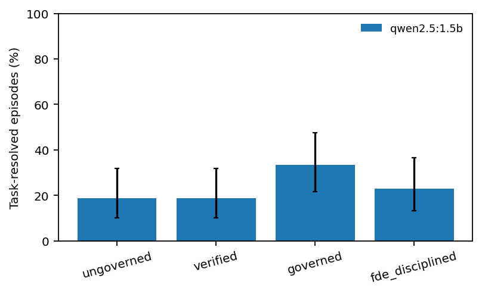

### Governance: the most important gap

| Metric | Result |
|---|---:|
| Required high-risk episodes | 30 total (15 per policy) |
| Contained the required approval marker | 0 |
| Combined approval coverage | 0/30 |
| Passed every task check while omitting approval | 11 |
| Normalized forbidden-claim safety violations | 0 |

**Why this matters:** the task checks do not require `requires_human_approval`. A high-risk artifact can therefore pass every check and still be unapproved. Calling those episodes “resolved” hides a delivery gap. Calling them “safe” ignores the missing gate.

The correct claim is narrow: **this harness does not currently certify governance readiness; it exposes the gap.**

### Cost: review time dominates

| Policy | Cost per episode | Cost per resolved task | Human reviews |
|---|---:|---:|---:|
| `ungoverned` | $0.59 | $3.14 | 2 |
| `verified` | $0.59 | $3.14 | 2 |
| `governed` | $4.70 | $14.11 | 16 |
| `fde_disciplined` | $6.47 | $28.23 | 22 |

The model ran locally, so token costs are **hosted-equivalent shadow prices**, not an invoice. Human review is priced at a loaded $254,000 annual cost over 1,800 working hours and a six-minute review assumption. At low resolve rates, the review line dominates.

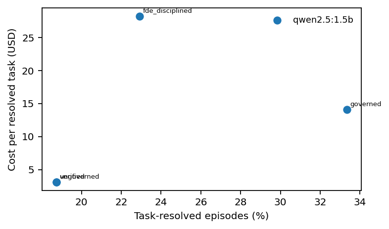

### Market: the role is real; the title is fuzzy

| Metric | Snapshot |
|---|---:|
| Public postings collected | 3,473 |
| FDE-like postings | 670 (19.3%) |
| Explicit forward-deployed titles | 229 (6.6% of all) |
| Remote share, FDE-like | 24.2% |
| Postings with a parseable salary mention | 205 (30.6%) |
| Median salary mention | $182,000 |

The broad class includes solutions, customer, and deployment engineering titles. Salary figures are a keyword-adjacent heuristic, not a verified compensation field. The snapshot is a point-in-time census of public ATS boards, not the whole labor market.

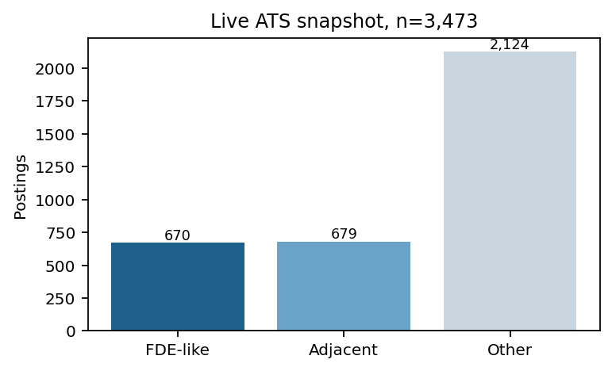

### Guardrail: a tradeoff, not a badge

| Detector | Precision | Recall | F1 | False-positive rate |
|---|---:|---:|---:|---:|
| Regex rules | 100.0% | 3.3% | 0.063 | 0.0% |
| TF-IDF + LR @0.5 | 87.0% | 77.0% | 0.817 | 6.8% |
| TF-IDF + LR @0.417 | 65.2% | 95.1% | 0.773 | 30.1% |

The high-recall operating point is a plausible **review-queue signal**, not a silent block. The false-positive rate is the business cost.

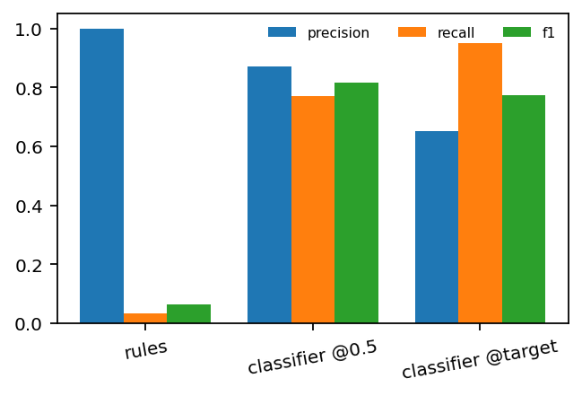

### Deployment: “it starts” is not “it works”

| Evidence | Result |
|---|---:|
| Canonical smoke tests healthy | 3/3 |
| Generated artifacts parsed to a Compose services map | 1/32 |
| Generated stacks executed in the reported run | 0 |

The canonical tests cover P01 liveness, P02 cache dependency, and P03 worker/queue restart. They do not exercise application logic. Generated deployment artifacts were parsed but not executed, so the repository does not claim that generated stacks run.

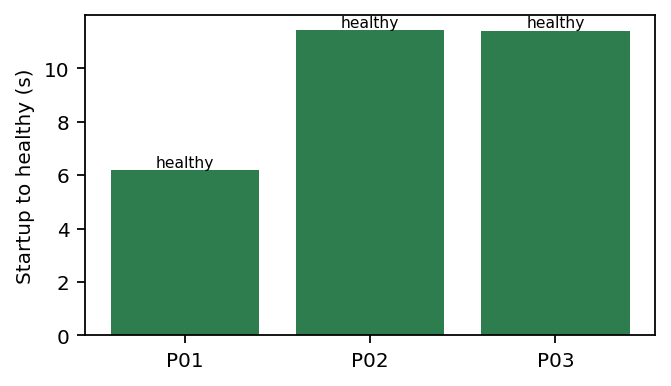

---

## 🚀 Quick start

### Just want to understand it?

1. Open [`preview.html`](preview.html) in a browser.
2. Start with the **60-second brief**.
3. Open **Learn** and take the six-question quiz.
4. Read [docs/RESEARCH.md](docs/RESEARCH.md) for the full methods and limitations.

**No terminal?** Use the GitHub **Code → Download ZIP**, unzip the folder, and open `preview.html`. Nothing needs to be installed.

### Want to inspect the evidence?

```bash
git clone <repository-url>   # replace with this repository's URL
cd ai-fde-research
python3 -m venv .venv
source .venv/bin/activate
pip install -r requirements.txt

make test
make verify
```

`make verify` checks that the frozen run, figures, tables, and result files are present and internally consistent. It may report warnings for preserved parse errors; warnings are not silently discarded.

### Want to regenerate the analysis?

```bash
# Rebuild the task bank and self-check reference artifacts
make tasks

# Recompute the analysis from the frozen run
FDE_EPISODES=results/frozen/benchmark_episodes_final.jsonl make cost stats figures report verify

# Optional: rebuild the LaTeX numbers and tables
make report
```

The full benchmark and market commands require external services and local model infrastructure. See [docs/RESEARCH.md](docs/RESEARCH.md) for the complete environment.

---

## 🔒 Data integrity and reproducibility

| Control | Detail |
|---|---|
| Frozen rows | 192 |
| Frozen SHA-256 | `20a6739ab4511d4264426a12edef0fbd684628caa5310f5af52ae0a3c0e38a21` |
| Run seed | `20261022` |
| Temperature | `0.0` |
| Model | `qwen2.5:1.5b` via Ollama |
| Policies | `ungoverned`, `verified`, `governed`, `fde_disciplined` |
| Verification | `ok` with 15 preserved warnings |
| Data license | CC BY 4.0 for task bank and generated results |
| Code license | MIT |

The verifier is intentionally conservative: it checks the frozen archive, task bank, figures, result totals, and generated LaTeX. It does **not** claim that every research choice is correct. Read [Threats to validity](docs/RESEARCH.md#threats-to-validity) before quoting a number.

---

## 🧠 Limitations — what this does not prove

- **Not a model ranking.** The reported run uses one 1.5B local model, one repeat, and a visible rubric.
- **Not a population estimate.** 48 rows come from 6 templates and 13 distinct instruction strings; intervals treat rows as exchangeable and are optimistic.
- **Not a safety certificate.** The normalized forbidden-claim counter is 0, but approval coverage is 0/15 per policy (0/30 combined) and the checks do not include approval.
- **Not proof that repair never works.** The null result is specific to this policy, model, and task bank.
- **Not proof that governance improves task quality.** The governed comparison is confounded by prompt changes and a small sample; the overall Friedman test is p=0.0753.
- **Not a deployment guarantee.** Generated artifacts were parsed, not executed; canonical tests are liveness checks.
- **Not a representative labor-market census.** The market snapshot is directional and title-sensitive.
- **Not financial advice or a guaranteed ROI model.** The cost model is a shadow-price planning tool.

**If a claim cannot survive these caveats, do not put it in a sales deck.**

---

## 🧭 Three readings, one evidence base

| Lens | Strongest takeaway | The question to ask next |
|---|---|---|
| **Business** | Completion is not readiness; approval and review cost belong in the pilot design | “What is our approval gate, and who owns the review queue?” |
| **Engineering** | The repair loop was a null result; error handling and task design matter more than adding process | “Which phase fails, and what evidence would change our mind?” |
| **Research** | A small, frozen, reproducible probe can still expose a real measurement gap | “What would a larger, pre-registered, multi-model study show?” |

No invented testimonials. No customer logos. The evidence is the argument.

---

## ❓ FAQ

<details>
<summary><strong>Is this a product I can deploy?</strong></summary>

No. It is a research harness and a business-readable evidence set. A deployment would need your own model, data, approval policy, security review, and operating support.

</details>

<details>
<summary><strong>Why is 16/48 not headline “governance works”?</strong></summary>

Because the comparison is not a clean causal test. The governed prompt bundle changes behavior, the sample is small, and the overall Friedman test is p=0.0753. The honest headline is the approval gap: 0/15 in each governed run (0/30 combined).

</details>

<details>
<summary><strong>What does 0/15 per run mean exactly?</strong></summary>

In each of the governed and disciplined runs, 15 high-risk episodes required human approval and none contained the required marker. That is 0/30 combined. Eleven of those 30 episodes passed every task check anyway. This is a gap in the measurement and the process, not a claim that every output was harmful.

</details>

<details>
<summary><strong>Why are there 15 errors?</strong></summary>

The model produced malformed or unparsable outputs in some cells: 2 ungoverned, 2 verified, 1 governed, and 10 disciplined. The errors are preserved in the frozen data and reported, not dropped.

</details>

<details>
<summary><strong>What is the difference between task resolution and safety?</strong></summary>

Task resolution is “all checks passed.” Safety in this repository is a normalized forbidden-claim check. Governance is “the required approval marker is present.” They are three different constructs. A single green badge cannot represent all three.

</details>

<details>
<summary><strong>Can I reuse the task bank?</strong></summary>

Yes, under CC BY 4.0 with attribution. The code is MIT. If you adapt the tasks, say what you changed and keep the denominator visible.

</details>

<details>
<summary><strong>What should I measure in my own pilot?</strong></summary>

At minimum: resolution on your own tasks, approval coverage, human review minutes per resolved task, error rate, deployment evidence, and a held-out task set. Pre-register the decision rule before you start.

</details>

<details>
<summary><strong>Where should a beginner start?</strong></summary>

Read the [Beginner guide](#-beginner-guide--read-this-and-you-are-a-professional), then open the [interactive learning lab](preview.html#learn). The quiz is designed to test concepts, not memorization.

</details>

---

## 📚 Glossary

| Term | Plain-language meaning |
|---|---|
| **FDE** | Forward-deployed engineer: embeds with a customer and delivers the last mile of an AI system |
| **Task** | A small unit of work with a brief, evidence, instruction, and checks |
| **Check** | A machine-verifiable condition that must pass for a task to be resolved |
| **Policy** | The process around the model: calls, repair, approval, critique |
| **Resolved** | Every task check passed |
| **Governance** | Whether a high-risk action has the required human approval and controls |
| **Guardrail** | A detector that flags or blocks risky input; it has a recall/false-positive tradeoff |
| **Shadow price** | A planning price for a resource that was not directly billed |
| **Null result** | The intervention did not change the outcome in this run |
| **Frozen run** | A hashed, normalized snapshot used for all reported analysis |

---

## 🗺️ Roadmap

- [x] Freeze the 192-episode run and publish the analysis
- [x] Separate task resolution from approval coverage
- [x] Add a business-readable preview and beginner path
- [x] Add social preview, screenshots, GIF, and walkthrough
- [ ] Add a multi-model, multi-repeat replication
- [ ] Put approval into the task checks and re-run the benchmark
- [ ] Execute generated deployment artifacts in an isolated environment
- [ ] Publish a short pilot-design worksheet for buyers

The roadmap is intentionally modest. A larger claim needs a larger study.

---

## 🤝 Contributing

Contributions are welcome once the repository is public. Good first contributions:

- Add a task with a reference artifact that passes its own checks.
- Improve the beginner guide or quiz without weakening the caveats.
- Add a reproducibility check for a result file.
- Report a broken link, inaccessible interaction, or unclear claim.

Please keep the distinction between **task quality**, **governance**, and **deployment evidence** explicit. Do not add a leaderboard that hides the denominator.

---

## 📄 License and citation

- **Code:** MIT — see [LICENSE](LICENSE).
- **Task bank, figures, and generated results:** CC BY 4.0 — see [LICENSE-DATA](LICENSE-DATA).
- **Paper text:** see the repository license files and the paper source.

```bibtex
@misc{fde_lifecycle_2026,
  title  = {FDE Lifecycle Lab: A Measurement Study and a Null Result for Check-Driven Repair},
  author = {AI FDE Research},
  year   = {2026},
  note   = {Code, task bank, and frozen results: ai-fde-research}
}
```

---

## 🧾 Project status

**Research preview · public-data only · no customer data.** The analysis is frozen and reproducible; the commercial interpretation is not. Use the evidence to ask better questions, design a safer pilot, and measure the operating model — not to skip it.

[Back to top](#fde-lifecycle-lab)
